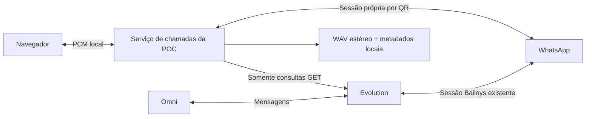

# Homologação da prova de chamadas

Implementação: [`experiments/whatsapp-chamada`](../../experiments/whatsapp-chamada/README.md). Worktree solicitada: `../omni-chamada`; branch `feat/whatsapp-chamada-poc`.

## Objetivo

Comprovar uma chamada individual de voz com gravação dos dois participantes e mensagens funcionando na Evolution 2.3.7. O modo original usa uma sessão de voz independente. A etapa iniciada em 09/11/2026 implementa uma ponte experimental para usar **um único pareamento**, com a Evolution como dona da sessão. O usuário confirmou nesse modo chamadas reais recebidas e efetuadas, gravações com as duas vozes audíveis e mensagens chegando ao Omni durante e depois da ligação. O fluxo principal da POC está validado nos aparelhos utilizados.

O diagrama abaixo representa o modo original. O desenho de pareamento único está no [guia da ponte](../../experiments/whatsapp-chamada/evolution-bridge/README.md).

## Preparação

- Uma linha de teste pareada à Evolution de desenvolvimento e cadastrada no Omni de desenvolvimento; nenhum número usado por clientes ou pelo Prisma.
- Um segundo aparelho Android e um iPhone, ambos sob controle da equipe; telefones incluídos na lista `CHAMADA_NUMEROS_TESTE`.
- Navegador Chrome ou Edge, microfone e fones. Confirmação prévia de que os participantes sabem que o teste será gravado.
- A mesma linha definida em `CHAMADA_LINHA_TESTE`. No modo `propria`, pareada também à POC como outro aparelho conectado; no modo `evolution`, somente o pareamento da Evolution é usado.
- `rejectCall=false` na Evolution de teste. A POC verifica, mas não altera a configuração.

## Matriz de validação real

Em 09/11/2026, o usuário confirmou chamadas reais recebidas e efetuadas funcionando perfeitamente e gravações boas, com as duas vozes bem audíveis, no modo de pareamento próprio. A Evolution estava desconectada durante esse primeiro teste, portanto a convivência do desenho original não foi validada.

Na mesma data, após ativar a ponte, o usuário confirmou que as chamadas também funcionaram nos dois caminhos pelo pareamento único. O painel foi conferido em `CHAMADA_CONEXAO=evolution`, conectado. Em seguida, confirmou também as gravações com as duas vozes audíveis e as mensagens chegando ao Omni durante e depois da ligação. O sistema operacional dos aparelhos não foi informado; as linhas específicas de Android e iPhone continuam pendentes.

Não marque outros cenários como aprovados só porque o teste simulado passou ou porque as chamadas básicas funcionaram.

| Cenário | Evidência esperada | Estado |
|---|---|---|
| Chamada real efetuada — pareamento próprio | Ligação estabelecida com áudio nos dois sentidos | Confirmado pelo usuário em 09/11/2026 |
| Chamada real recebida — pareamento próprio | Atendimento no painel com áudio nos dois sentidos | Confirmado pelo usuário em 09/11/2026 |
| Chamada real efetuada — pareamento único da Evolution | Ligação estabelecida pelo motor de voz usando a sessão da Evolution | Confirmado pelo usuário em 09/11/2026 |
| Chamada real recebida — pareamento único da Evolution | Atendimento no painel usando a sessão da Evolution | Confirmado pelo usuário em 09/11/2026 |
| Evolution antes da chamada | Estado `open`, mesma linha, rejeição desligada; mensagem recebida e resposta vistas nos dois lados | Pendente |
| POC → Android | Aparelho toca; ambos ouvem; encerramento libera os controles | Pendente |
| Android → POC | Chamada aparece no painel; atendimento e encerramento funcionam | Pendente |
| POC → iPhone | Mesmo resultado, sem áudio em apenas uma direção | Pendente |
| iPhone → POC | Recebimento e atendimento com áudio nos dois sentidos | Pendente |
| Mensagens durante a chamada | Mensagem chega ao Omni e resposta chega ao outro aparelho durante áudio ativo | Recebimento no Omni confirmado pelo usuário em 09/11/2026; resposta durante a chamada ainda não confirmada |
| Evolution depois da chamada | Novas mensagens chegam ao Omni depois da ligação | Confirmado pelo usuário em 09/11/2026 |
| Gravação — pareamento próprio | WAV reproduz ambos, silêncio funciona, duração corresponde ao período ativo | Duas vozes e audibilidade confirmadas pelo usuário em 09/11/2026; duração e silêncio na chamada real ainda pendentes |
| Gravação — pareamento único da Evolution | WAV reproduz ambos, silêncio funciona, duração corresponde ao período ativo | Duas vozes e audibilidade confirmadas pelo usuário em 09/11/2026; duração e silêncio na chamada real ainda pendentes |
| Encerramento pelo outro aparelho | Painel libera a linha; gravação é finalizada | Pendente |
| Atendimento pelo celular da linha | POC libera a chamada recebida quando outro aparelho atende; não grava conversa atendida fora da POC | Pendente |
| Rejeição e sem resposta | Estado e gravação sem áudio coerentes; mensagem continua funcionando | Pendente |
| Perda do navegador | Chamada controlada por ele termina; arquivo é finalizado | Pendente |
| Reinício | Sessão própria reconecta sem importar dados da Evolution; histórico concluído reaparece | Pendente |
| Destino fora da lista | Não realiza ligação; chamada recebida não é atendida automaticamente | Pendente |
| Chamada de alguns minutos | Sem perda progressiva de áudio; contadores de descarte observados | Pendente |

Use **Consultar Evolution** antes, durante e depois; registre também a entrega observada das mensagens. Baixe **Relatório do teste** e os WAVs necessários, guardando-os apenas na pasta privada do experimento. O relatório técnico não substitui a escuta do áudio e a observação da entrega.

## Implementação de um único pareamento

O usuário solicitou iniciar a etapa de mensagens e chamadas utilizando o mesmo pareamento da Evolution. O modo original (`CHAMADA_CONEXAO=propria`) continua disponível. Chamadas reais recebidas e efetuadas foram confirmadas tanto nele quanto no modo `evolution`. Dois QRs representam dois aparelhos conectados à mesma conta; essa separação, por si só, não comprova convivência durante uma chamada.

Foi identificado um caminho concreto para estudar a sessão única: a versão de HyperMeow já fixada no projeto implementa [`NewShadowClient` e `ShadowRelay`](https://github.com/polymorfa/hypermeow/blob/90f9e4ec2c88/shadow.go). Esse modo não abre seu próprio socket WhatsApp e delega ao cliente principal o transporte da sinalização, operações de criptografia e consultas de dispositivos e identidades. É uma base para um adaptador; não é uma integração pronta com a Evolution.

O desenho proposto mantém a Evolution/Baileys como proprietária da sessão. Uma ponte interna encaminha a sinalização de chamadas e as operações necessárias ao motor de voz, que continua responsável por áudio e gravação. A ponte precisa integrar o processamento de chamadas sem duplicar confirmações nem avançar as mesmas sessões criptográficas duas vezes. Compartilhar uma cópia dos arquivos de credenciais entre dois clientes conectados não implementa esse desenho.

A extensão da Evolution e o adaptador Go foram implementados em [`evolution-bridge`](../../experiments/whatsapp-chamada/evolution-bridge/README.md). O modo `CHAMADA_CONEXAO=evolution` usa o cliente shadow sem socket WhatsApp nem banco de sessões próprio. Um patch verificado por hash encaminha as chamadas individuais autorizadas antes do handler normal do Baileys; as mensagens continuam nele. O snapshot compartilha somente identidade pública. A ponte fica desligada por padrão e tem override Docker separado para a Evolution local.

Testes locais cobrem autenticação, linha e contatos permitidos, geração de sessão, queda do canal e o uso da mesma sessão Signal para mensagem comum e chave de chamada. O teste integrado Go ↔ Baileys executa sem rede externa e valida oferta enviada, encerramento recebido, oferta recebida e rejeição. **O teste automatizado não valida chamada real nem entrega de mensagens no Omni.** A ponte foi ativada no ambiente local e as chamadas reais nos dois caminhos foram confirmadas pelo usuário em 09/11/2026.

O fluxo principal pelo pareamento único tem confirmação real: chamadas efetuadas e recebidas, gravação audível dos dois lados e mensagens chegando ao Omni durante e depois da ligação. O [roteiro da ponte](../../experiments/whatsapp-chamada/evolution-bridge/README.md) continua como referência para os cenários adicionais ainda pendentes, incluindo reconexão e compatibilidade por sistema operacional. A convivência do desenho original permanece como não executada, e não como aprovada.

## Critério de continuidade

Integrar os controles ao Omni só depois de confirmar chamadas recebidas e realizadas em Android e iPhone, gravação compreensível dos dois lados e mensagens funcionando durante e depois. Problemas de compatibilidade do motor de voz devem ser resolvidos ou documentados antes de estimar uma entrega para uso da equipe.

O usuário esclareceu que o app está em desenvolvimento, sem instalação em produção, e definiu a propriedade pessoal de linhas e gravações. A integração nativa em desenvolvimento está descrita em [Chamadas pessoais no Omni](chamadas-omni.md): aba Chamadas, controle pela própria linha, gravação opcional com permissão, histórico com RLS e compartilhamento explícito. A POC isolada continua disponível; sua confirmação real anterior não substitui a homologação da interface integrada com dois usuários.
