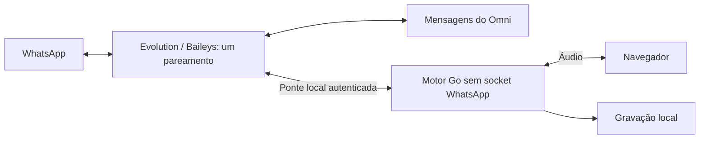

# Chamadas pelo pareamento da Evolution

Ponte experimental para a Evolution **2.3.7 / Baileys 7.0.0-rc.9** instalada no Omni. Mantém a Evolution como única dona do socket WhatsApp e das sessões Signal. O serviço Go usa `NewShadowClient`; não abre socket WhatsApp, não gera QR e não importa chaves privadas. Áudio e gravação continuam no motor já validado. O transporte de mídia da ligação continua separado da sinalização.

Implementado e testado localmente em 09/11/2026. **O usuário confirmou nessa data chamadas reais recebidas e efetuadas pelo pareamento único, gravações com as duas vozes audíveis e mensagens chegando ao Omni durante e depois da ligação.** O fluxo principal está validado nos aparelhos utilizados. Reconexão, compatibilidade por sistema operacional e demais cenários da matriz continuam pendentes.



## Ativar na Evolution local

Execute na raiz de `../omni-chamada`. A ativação **reinicia a Evolution de desenvolvimento** com outra imagem, conservando banco, Redis, instâncias e volume. Não execute outra Evolution em paralelo sobre esses dados. Não use este override em produção nem na Evolution do Prisma.

1. Em `experiments/whatsapp-chamada/.env`, conserve a linha A, o destino B e os limites existentes e acrescente:

   ```dotenv
   CHAMADA_MODO=teste
   CHAMADA_CONEXAO=evolution
   CHAMADA_PONTE_URL=ws://127.0.0.1:8097/v1/calls
   CHAMADA_PONTE_TOKEN=SUBSTITUA_POR_UMA_CHAVE_ALEATORIA
   ```

   Gere uma chave com `openssl rand -hex 32`; use somente no arquivo local, com permissão `0600`. O Compose entrega essa mesma chave à extensão da Evolution. A chave da ponte é diferente da chave geral da API da Evolution.

2. Construa as imagens:

   ```sh
   docker build -t omni-evolution:2.3.7-presence.1 deploy/evolution
   docker build -t omni-evolution:2.3.7-chamada-poc experiments/whatsapp-chamada/evolution-bridge
   docker compose -f docker-compose.chamada.yml build chamada
   ```

3. Ative a extensão **no projeto local já existente**. Neste ambiente, a chave geral da Evolution está no `.env` de `../omni`; somente as variáveis referenciadas pelos arquivos Compose são usadas. Não copie esse arquivo para a POC:

   ```sh
   docker compose --env-file ../omni/.env \
     --env-file experiments/whatsapp-chamada/.env \
     -f docker-compose.whatsapp.yml -f docker-compose.chamada-evolution.yml \
     up -d --no-build evolution
   docker compose -f docker-compose.chamada.yml up -d --no-build --force-recreate chamada
   ```

4. Conecte o número A **na Evolution**, pela Administração → WhatsApp do Omni. Se for necessário ler QR, leia apenas o QR fornecido pela Evolution. O gravador não usa um segundo QR nesse modo. A porta da ponte abre quando a Evolution cria o socket de uma instância.
5. Abra **http://127.0.0.1:8096** e clique em **Conectar à Evolution**. O painel deve mostrar **WHATSAPP · SESSÃO DA EVOLUTION** e a confirmação de que está usando o pareamento existente.

Reiniciar o painel encerra o socket próprio do experimento anterior; sua sessão SQLite e as gravações permanecem no volume. Não deixe um segundo processo do gravador conectado pelo modo próprio durante a homologação do modo unificado.

## Validar

- Confirmar mensagem recebida no Omni antes da chamada.
- Ligar A → B pelo painel, ouvir os dois lados e enviar uma mensagem de teste durante a chamada; conferir sua chegada no Omni.
- Ligar B → A, atender no painel e conferir a gravação dos dois lados.
- Conferir mensagem e resposta após a chamada, usando os controles normais do Omni e suas regras de ensaio/envio.
- Reiniciar a Evolution: o painel deve ficar desconectado e finalizar a chamada ativa. Depois de a Evolution reconectar, clicar em **Conectar à Evolution**, sem novo pareamento se a sessão continuar válida.
- Desconectar somente o gravador: mensagens continuam na Evolution. Sem um gravador inscrito, os eventos de chamada seguem o processamento normal da Evolution.

Os testes automatizados não comprovam negociação do relay de mídia no WhatsApp real, entrega de webhooks nem compatibilidade de aparelhos. A [matriz de homologação](../../../docs/integracoes/whatsapp-chamada-poc.md) continua sendo a referência.

## Voltar ao modo validado

Defina `CHAMADA_CONEXAO=propria` na configuração da POC e recrie apenas `chamada`. Clique em **Conectar linha**; o serviço usa seu SQLite anterior. Para retirar a extensão da Evolution, recrie seu serviço usando apenas o Compose original:

```sh
docker compose --env-file ../omni/.env -f docker-compose.whatsapp.yml up -d --no-build evolution
docker compose -f docker-compose.chamada.yml up -d --no-build --force-recreate chamada
```

Nenhum desses comandos remove volumes ou desvincula aparelhos no celular.

## Contrato e limites

- WebSocket interno `/v1/calls`, versão 1, `Authorization: Bearer`. Uma conexão do gravador, uma linha e somente destinos de teste. O navegador nunca recebe a chave.
- No Docker, a extensão escuta em `0.0.0.0:8097` **dentro do contêiner**, com publicação apenas em `127.0.0.1:8097` do host. Fora do Docker, o padrão da extensão é bind em loopback. A chave é obrigatória nos dois casos; `Origin` de navegador é recusado.
- Cada conexão Baileys tem um identificador de geração (`epoch`). Snapshot e inscrição precedem qualquer operação; reconexão invalida o gravador. Não há failover automático para uma sessão WhatsApp própria.
- Apenas chamadas individuais de voz de contatos autorizados são desviadas. O hook roda antes do handler normal de chamadas do Baileys, evitando duas confirmações e a rejeição automática da mesma chamada pela Evolution. Mensagens, grupos, recibos e notificações continuam no Baileys; somente ACKs de classe `call` são encaminhados ao motor.
- Nós usam um envelope JSON explícito para bytes, filhos e atributos. Assim, versões diferentes dos dicionários binários de Go e Baileys não corrompem os stanzas; `@lid` e os números de dispositivo são preservados.
- `encrypt` e `decrypt` aceitam apenas o protobuf de chave de chamada de 32 bytes. Padding é aplicado/removido no Baileys uma única vez. As operações usam o próprio `signalRepository` da Evolution, com as transações e os bloqueios do Baileys.
- Prekeys são buscadas e instaladas pelo Baileys (`assertSessions`); não são exportadas ao Go. O snapshot contém somente JID, LID e identidade pública assinada. Não há banco de sessões no backend shadow.
- Consultas de LID, telefone, dispositivos e token de privacidade ficam no dono da sessão. A consulta de conta normaliza o telefone devolvido pelo WhatsApp antes de resolver o LID, inclusive no formato brasileiro sem o nono dígito.
- Filas e mensagens têm limites. RPC tem timeout de 15 s; heartbeat verifica o canal a cada 20 s. Falha da ponte encerra a chamada controlada e exige reconectar o gravador.
- O patch verifica os hashes dos dois arquivos Baileys antes de alterar qualquer um. Outra versão precisa de revisão explícita; não é aplicado por aproximação. O patch de presença existente é preservado.

## Testes sem telefones

```sh
# Go 1.27 e Docker; não lê .env nem monta sessões reais.
bash experiments/whatsapp-chamada/evolution-bridge/test.sh
```

O script testa o servidor com identidades Signal efêmeras, inclusive uma mensagem comum entre operações de chave de chamada. Depois executa o motor Go e o adaptador Node juntos em um contêiner **sem rede**, com apenas loopback, sem volumes da Evolution ou da POC. Valida descoberta de dispositivos, criptografia real do Baileys, oferta enviada, encerramento recebido, oferta recebida, resolução do telefone e rejeição. O teste não abre conexão com o WhatsApp nem realiza chamadas reais. `go test -race ./...` cobre concorrência do cliente RPC separadamente.
